# 1024特辑：AI还有多久才能取代人类

## 从辅助补全到自主完成任务：Agent有什么魔法？

大概是22年的时候，xa大佬向我展示了一个叫做Copilot的VSCode插件，把题目粘到注释里，然后按几下Tab键，代码就全出来了，而且运行起来还是对的，当时我对AI的印象还只停留在聊天，AI能直接在编辑器中写出代码，写出的代码还似乎是我想要的，这对我可谓是惊为天人。

我本以为这就是AI辅助生成代码的最佳形态，直到26年一切都不一样了。26年年初出现了让AI调用工具控制电脑的OpenClaw，虽然小龙虾只流行了几个月便销声匿迹，但随之而来的是如雨后春笋般爆发的各种Agent。起初我对Agent并不在意，认为不过只是用于写代码的OpenClaw，而且我也试用了Copilot的Agent模式，调工具调不明白，写点小的功能也写不明白，所以断定为AI暂时还只能辅助编码，没法取代人类。

显然AI的进步比我想象中的要快得多，随着GPT-5.6的发布，AI的能力突然出现了一个拐点。在越来越大的模型参数、越来越多的训练数据和思维链的加成下，模型的能力已经变得很强了，它所欠缺的只是一个能力，一个能进行工具调用的能力。GPT-5.6这一代做了大量的后训练，让模型有了极强的结构化输出和指令遵循能力（虽然还是会和PowerShell打架），这使得Agent真正成为了可能，Agent可以自行进行需求分析、编码和测试工作，无需人类干预就能像人类一样完成长程任务。

Agent的雏形确实早在25甚至24年就已经有了，但是当时的模型缺少这些能力，连最基本的指令遵循都做不到，毕竟工具是死板的，模型必须按指定格式输出才能正确被工具识别，所以当时的Agent就只是一种概念验证，几乎无法实际使用。在我看来，模型的能力是远比Agent的能力要重要的，如果模型够强，Agent就能做得更薄。例如pi agent就是一个很好的例子，它只有最基本的读写和命令执行能力，但是在各种评测中都处于top级别，丝毫不弱于其他Agent。

Agent并没有什么魔法，它的原理很简单，就是一个死循环，每个循环都先接受输入（如果用户没输入就跳过），再进行思考决定下一步怎么做，接着调用工具，最后根据执行结果再思考下一步怎么做，直至达成目标，这就是ReAct，因为其接近于人类思考解决问题的方式，因此成为了当今Agent的主流架构。真正的魔法在于模型，再好的Agent配上一个弱智模型，也只能输出阿巴阿巴；而即使是你自己手搓的一个200~300行的ReAct架构Agent配上最新最好的模型，也几乎不会比主流Agent差多少（除非它对自家Agent过拟合了，说的就是你DeepSeek V4）。

## 这是一个成年男性连续使用100天Agent发生的变化

本着可以不用，但不能不会的思想，我也决定学习一下Agent的原理和怎么用。所以我买了1个月的qwen coding plan（qwen太区了，后来不买了）和3个月的GLM Coding Plan套餐（图里只有付费套餐的用量，免费蹬的用量不包含在里面，保守估计至少得有100亿），再加上DeepSeek充了点钱，中转站的GPT，以及各家Agent的一些免费额度，我估计我这三个月大概用了200亿的token（可能不止）。

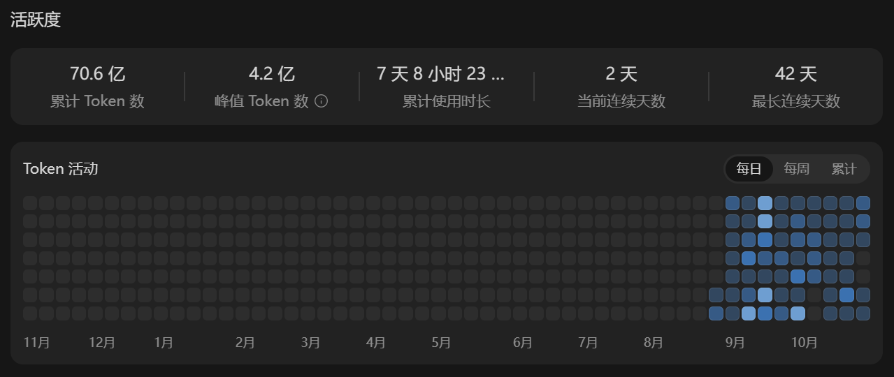
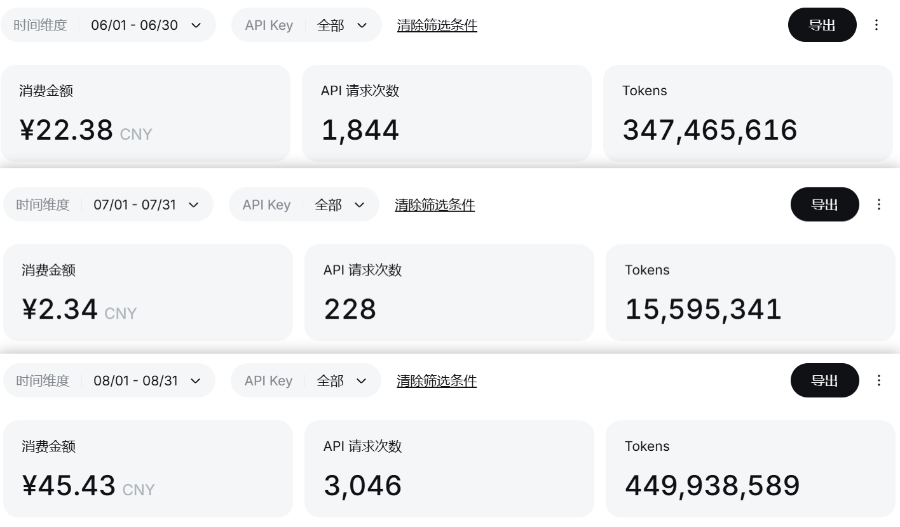
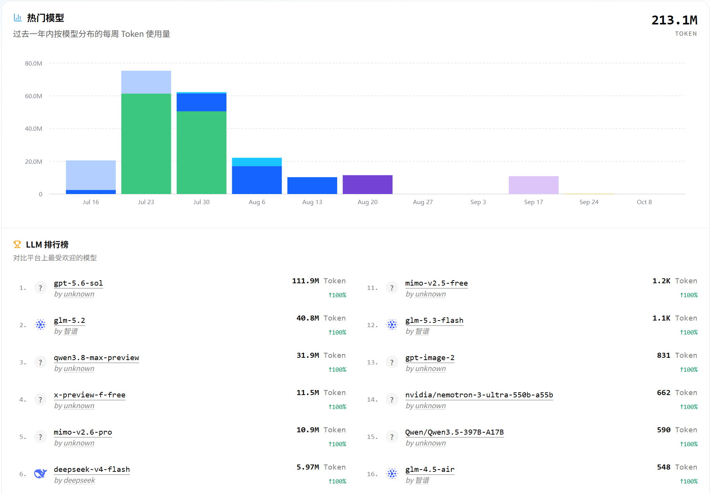

在这三个月里，我让AI做了很多事情，有些是古法编程，有些是纯vibe coding，也有些是古法vibe coding。在做这些项目的过程中，我发现很容易就能触摸到AI的上限，下面我举一些例子吧。

先看一下纯vibe coding的吧，感受一下AI的能力，这些基本上都是GLM 5.3 Flash（少部分5.3f无法实现的换成了5.3去做）和DeepSeek V4 Flash做的，还不是最前沿的模型：

1. 咖啡馆点餐系统：一个既能点饮品，又能点歌的平台
  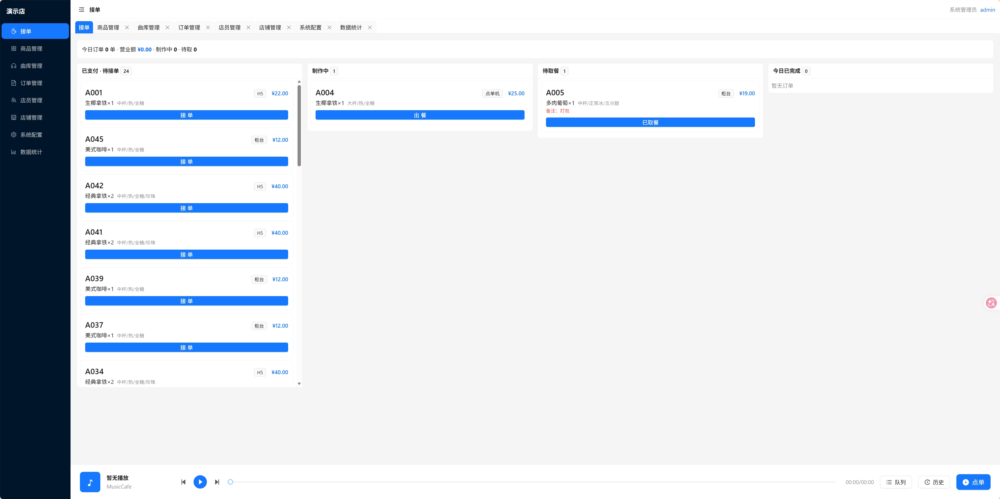
  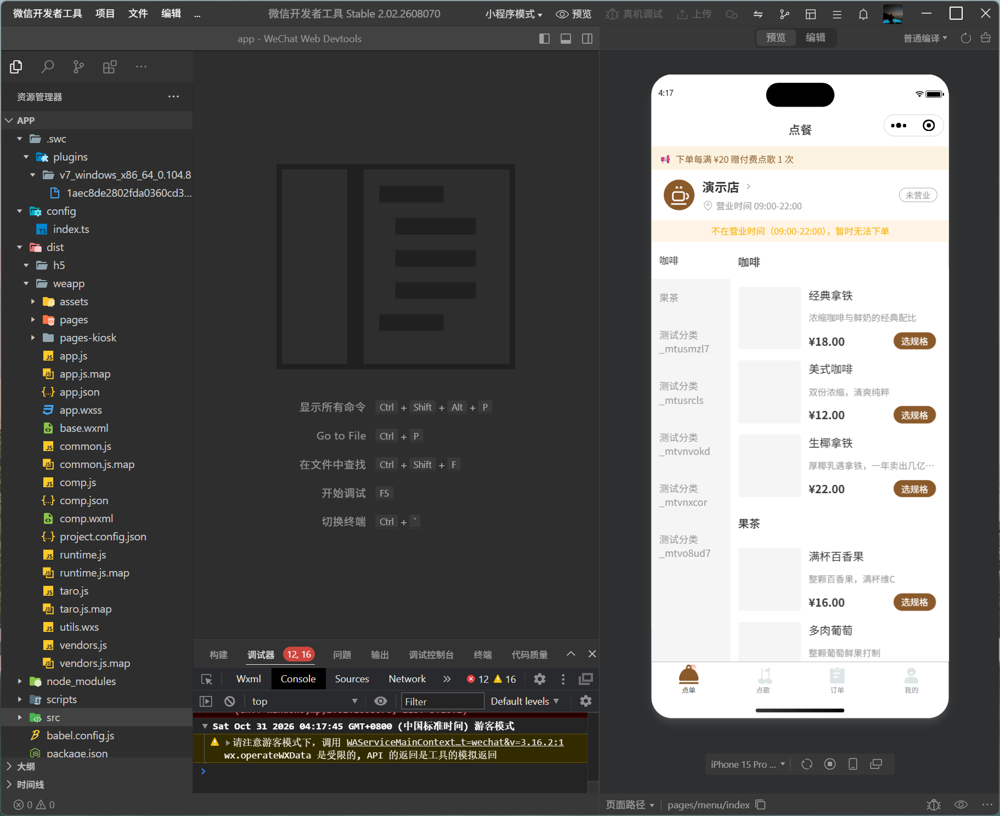
2. KTV系统：先分离人声，再计算音调，然后根据你唱的进行评分
  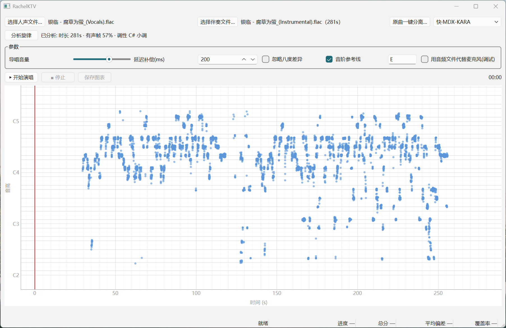
3. 歌曲人声分离App：在端侧部署人声分离模型，支持几乎所有的端侧推理框架
  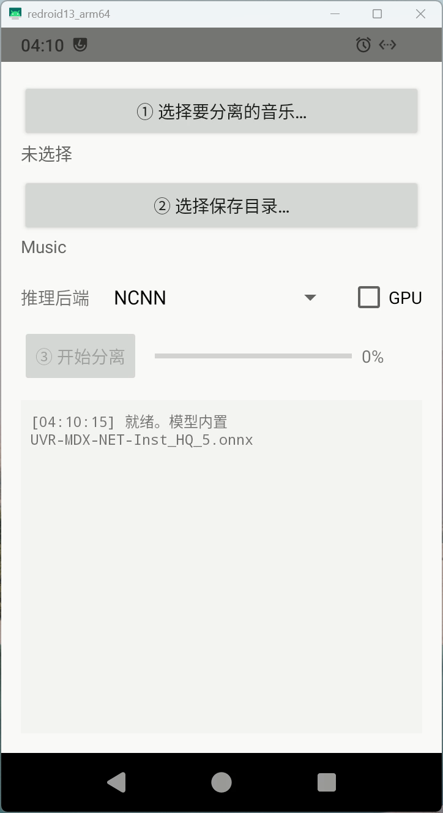
4. [小小枪战H5重置版](https://h5.dawncraft.cc/tiny-gun-war/)：高中时候每天中午都在教室电脑上玩的Flash小游戏，移植到了Cocos Creator上（注意：框架是古法编程在19年搭建的，但是GLM 5.3f并没有用我搭的框架，而是自己造了一套，所以算vibe）
  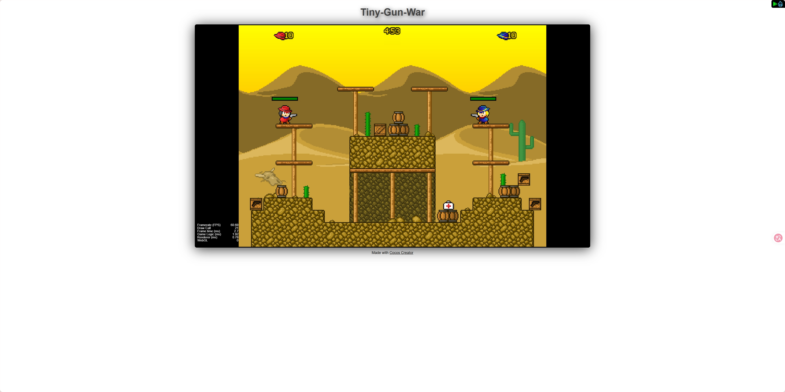
5. [学校模型预览器](http://13.dawncraft.cc/)（模型不是AI建的，是15年前的圣遗物）
  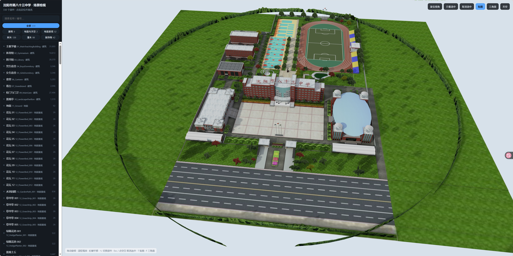

再看一下古法结合vibe的实例，其效果及代码质量和纯vibe相比都要高上不少：

1. [PreCess的跨平台和WASM移植](https://precess.dawncraft.cc/)：PreCess，现名ZenithGrid，是一款面向CAE的网格前处理软件，集成模型导入、网格编辑与可视化，并通过插件扩展算法能力，服务于算法研发与工程应用。本次迭代将其适配了Linux/macOS平台，并将其大部分功能通过WASM技术完整移植到了网页端
  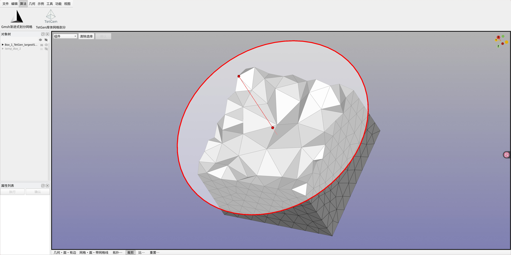
2. CoralReefMobile：CoralReefMobile是由大连理工大学OurEDA实验室开发的移动端水下机器人控制App，在DeepSeek和GLM的帮助下，使用KMP技术实现了Android/Harmony/iOS三端跨平台，三端界面和功能完全一致
  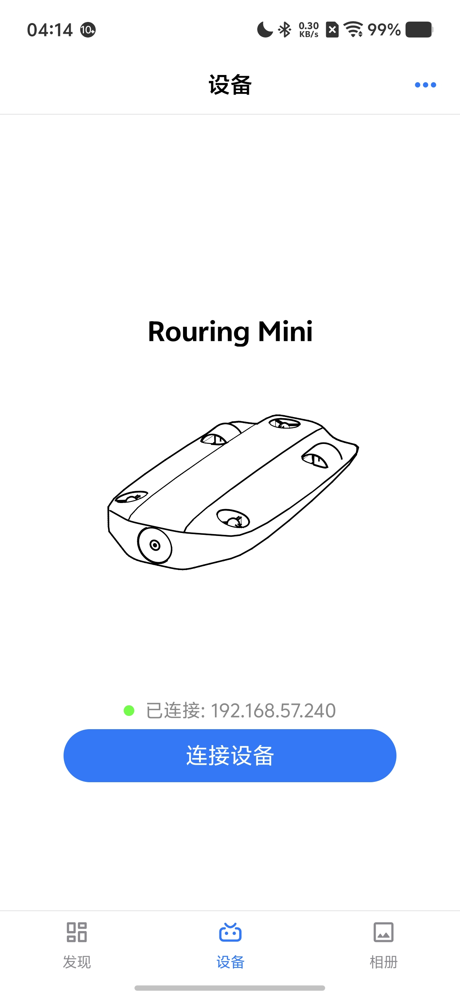
  
3. 墨水屏相册：在Claude Opus 4.5和GPT 5.4的帮助下实现了图片压缩算法
  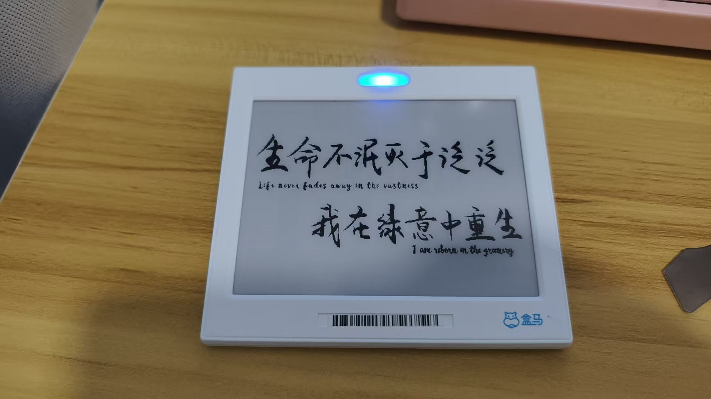

最后还要举一个反例：

// TODO 补充CoralReefPlayer例子

接下来肯定会有AI无脑吹要开始反驳我了，肯定是你用的模型太垃圾，或者是没有写事无巨细的提示词，没有spec-driven development。不过你要知道上面的咖啡馆点餐系统就是使用SDD开发的，但是其效果上仍然远不如古法结合AI辅助开发的CoralReefMobile。

上述的一些例子我会作为我自己的benchmark放在<https://github.com/DawningW/wls-bench>，用于测试前沿模型是否能达到我的要求，欢迎围观，或者干脆帮我测一下，因为我没钱用不起最新最好的模型:)

结合上面的实测，我大概能给这几个月的国模简单排个序（纯主观评测，仅代表个人观点）：

// TODO 补充模型评测

（以上模型均以最大思考强度对比，本来就蠢，不开max能用吗，GPT和Claude不参与此次对比，因为没必要）
总的来说我认为的模型趋势：大参数量+后训练>大参数量>后训练>小模型

根据以上现象，我提出四个看法：

1. 关于后训练：做完后训练和没做后训练的模型简直判若两个模型，尤其是Qwen 3.8 Max，现象非常明显。后训练的确是提升模型能力的有效手段，但是我认为后训练只能提升下限，不能提升上限。智谱现在走的路线就像华为的韬定律，因为拿不到卡，算力不足以训练和部署参数量过大的模型，于是只能卷后训练，就像华为因制程受限而只能靠堆叠实现更大的等效密度而已，短时间内这么做一定有提升，但长时间来看上限不高，迟早也会遇到瓶颈，到时候提升的速度就会远慢于参数量的提升。主要还是大模型的参数量提升要比芯片制程提升简单，芯片制程提升受限于量子隧穿效应，越往上提升越困难；而大模型从几百B提升到1~2T，以国内目前的算力还是能做到的，就像Kimi那样，当然Kimi后训练做得太差了。
2. 关于蒸馏：从上一代国模（8~9月的模型）的推理结果可以看得出来，蒸馏是一定蒸了的，不然没办法解释GLM 5.3和Qwen 3.8为什么思考过程和结果都和GPT 5.6 Sol几乎一样，而DeepSeek直到V4-1017才能解决crp的bug，说明DeepSeek反倒是没蒸馏的那个（或者蒸得不多）。但是蒸馏远算不上提升模型能力的有效手段，只是对缺乏训练的小模型来说蒸馏的效果很好，模型能力越强，蒸馏的效果就越微乎其微，更何况现在GPT和Claude都不给看思维链了，凭空蒸馏吗。再退一步讲，如果蒸馏真的这么有效，能让我以DeepSeek价格用到Claude水平的模型，那都给我蒸，给我狠狠地蒸！
3. 关于价格：GPT和Claude其实比国模便宜，国模才是又贵又垃圾。只是因为我是古法编程的，AI对我来说只负责实现，只是节省了大量我实现的时间，而目前的所有主流模型在实现代码上都不差，毕竟相互蒸来蒸去的，所以我对模型没有要求（别给我用MiniMax那种区就行），没必要为了GPT和Claude费劲地充钱，还得伪装防止被封号。上面有很多vibe coding的例子是因为那两周GLM 5.3 Flash夜间免费，再加上各家Agent都在送免费额度，我就搞了几个goal让AI自己跑而已。
4. 关于隐私：国模还有最大的问题，所有家的coding plan都在用户协议里明确写了会使用你的数据进行训练，无法关闭，除非是企业plan或者API计费，甚至智谱zcode还会直接上传整个仓库。不是说不给你们数据训练，用我的代码训练之后说不定AI写的代码就更符合我的想法了，这是好事啊，但是你们吃相得好看点吧，是不是得在显眼的地方注明，而不是在那默默地偷我数据，至少要让用户有知情权。

AI用多了人确实会产生一种惯性，对AI产生过度依赖，懒得自己思考。好在现在的AI对我来说还是弱智，尽管宣称能自主完成长程任务，自己实现一个完整的项目，但细看实现还是一团乱麻，远不如我自己写，所以降低了我对AI的依赖。如果AI再发展下去，或许我也会被AI夺舍吧。

## 再谈软件工程

用了三个多月AI做了这么多项目，AI能解决什么，不能解决什么，我认为我已经很清楚了。尽管我用的并非最前沿的AI，但是我仍然坚持我的看法：在AI时代，软件工程不会消失。

在前年的1024特辑中，我将软件工程分为两个部分：微观层面上的软件工程和宏观层面上的软件工程。微观层面指的是代码的具体实现、测试、设计模式、坏味道等等，这些现在就已经可以完全交给AI了，别用太差的模型就行（DeepSeek-V4-Flash-1017或更强水平的模型）；而宏观层面指的是需求分析、架构设计、团队协作等，这些方面现在还必须依靠人在环路。毕竟项目是你自己的，如果连需求分析都交给AI，那做出来的东西就不一定是你想要的了；架构设计如果交给AI，那要么过度设计，要么压根就没设计，取决于AI的能力和你开的思考等级，反正就不是你想要的，除非一点代码都不看，否则很难接受。

Frederick P. Brooks在《No Silver Bullet》里将软件工程问题划分为两类：本质困难和偶然困难[^1]。本质困难指的是软件特性中固有的困难，是由软件的复杂架构和业务需求带来的，无法通过更先进的工具直接“抹平”；而偶然困难指的是在软件开发实现过程中遭遇的，并非软件本质固有的问题（如编程语言复杂、工具落后、框架难用、甚至是网络不通拉不下来依赖等）。

因此Brooks在1986年提出了著名的观点：“软件工程没有银弹”，并且认为在10年内这句话都会成立。事实证明他还是过于保守了，这句话直到40年后仍然成立。以我的经验来看，在规模不是特别大的项目中，偶然困难的占比要在75%以上，远大于本质困难的比例，考虑到现在的AI能够解决几乎所有的偶然困难，相比于人类开发效率提升了不止10倍，结果就是剩下的全是本质困难，人类工程师反倒更累了，因为本质困难要靠思考、推理、对齐来解决，不像偶然困难，大多数只需要挨个尝试、机械化试错就能解决。所以软件工程在AI时代更加没有银弹了。

越是经验丰富的软件工程师，其遇到的本质困难的占比就越大，而对于初学编程的新手来说，其偶然困难可以占到99%以上。这样对于新手来说，AI可以解决他99%的问题，而剩下的1%他根本就感知不到，AI就默默帮他做出了决定，因此会感觉AI无所不能。当他进一步开发项目，项目规模达到一定程度时，会发现新增一个需求需要改好多处代码，花了好多token也改不对；或是修好一个bug后又多出了很多个bug。这时候他会认为是AI不够强，寄希望于下一代AI能解决这些问题，而不会意识到这是软件的本质困难（当然现在的AI也确实不够强）。

这并不是说我们就要抱着《人月神话》不放了，毕竟这本书写于半个多世纪前，在当今的视角来看还是有些局限性的。刚才说过人类工程师在AI环路里会变得更累，一方面是AI的开发效率是同等级人类工程师的10倍以上，而人类要对AI写的代码负责，要review代码；另一方面是当AI解决了所有偶然困难后，人类就不得不投入脑力去解决一个接一个的本质困难，没有喘息的时间，所以会感觉非常累。换句话说，人类是AI环路里最孱弱又最不可或缺的一环，那么根据木桶效应，如何优化人类的效率就成为了AI软件工程最需要探讨的部分了，例如引入多Agent协作，多轮检视后再走到人类；又或者是引入SDD，和AI（以及其他人）充分探讨需求后再开始开发（尽管由于软件的可变性，我觉得这没太大用），减少AI的幻觉。总之这一切还需要我们进一步地摸索和研究，毕竟Agent真正开始流行起来也才不到半年的时间。

这里有时间建议去听一听蒋炎岩老师的课（bilibili：绿导师原谅你了），之前他一直都在南京大学为本科生讲授操作系统原理这门课，讲得很好，但自从今年Agent火了以后直接就转行了，改教AI软件工程了，值得学习一番。

[^1]:详见《人月神话》第16章

## 有所能，有所不能

这节是对之前几节的详细论证。

大佬们的思维和观点都是相似的，只有做大模型的公司和营销号在那各种吹Agent取代程序员，一个是不吹就没法维持股价，另一个是纯散播焦虑。

前面说过Agent能力的提升几乎完全来自于模型的提升，Agent已经没什么可卷的了，所以就发明了很多新词：mcp、skill、loop都是没用，subagent，工作流稍微有点用吧，用处在哪呢，在于token烧得更快了。理解一个东西一定要从原理入手，就像是我上学的时候不爱背二级结论，考试的时候现推一样。LLM的本质是decoder-only transformer，根据前面的词预测后面的词，Agent的本质是ReAct，是思考-行动循环，所有的东西都是提示词，mcp是告诉AI用什么代码能调用哪些工具，skill是一堆可复用的提示词，loop是让AI干完之后接着干，subagent主要是为了不让无用的信息占用主agent宝贵的上下文，workflow则对agent进行编排，使其工作流程更像人类实际的开发方式，这些东西的本质没有区别，只是给这些约定俗成的范式起了个名字，最大的作用就是浪费我的token，让我的账单爆炸。

例如我前几天有逆向一个Android App的需求，这个App的壳算是比较简单的一档，所以我打算用GLM 5.3加上最近很火的REA来试试，结果不试不知道，一试傻眼了，这REA要足足用掉200k上下文，本来我就只开了500k上下文（GLM 5.3太贵了，而且上下文太长注意力比较弱，虽然比GLM 5.3 Flash强点但是也流口水），结果频繁触发压缩，无法利用缓存，额度也哗哗地掉，在用掉了3张重置卡之后我实在受不了把REA关掉了，结果逆向的能力并没有下降（当然要提前告诉AI工具都放在哪了）。

这里我的观点和公司内一位专家是相同的，我们称之为柱子哥，虽然他从事的是芯片架构设计，但是对软件工程和AI有着非常独到的见解，这里贴一下他的观点：<https://mysummary.readthedocs.io/zh/latest/%E8%BD%AF%E4%BB%B6%E6%9E%84%E6%9E%B6%E8%AE%BE%E8%AE%A1/AI%E7%BC%96%E7%A8%8B%E4%B8%AD%E4%BA%BA%E7%9A%84%E4%BD%9C%E7%94%A8.html>

接下来我还要介绍一位大佬，jiaqi教练，前微软工程师，万星项目Notepads的开发者（这是xa大佬上大学之前用的文本编辑器，世界很小吧），现就职于我司从事九问iCode Agent的设计与开发工作，他在公司内部也算是AI的前沿探索者了，而且他的很多观点我都是非常认同的，就例如他10.23在公司内的一个茶话会上说的，具体的原文我不能复述（其实是我不记得了），但是我可以大概描述他的观点，再加上我的看法。

AI使用人类的语料进行训练，又怎么能跳脱出人类的思维。假如真的不考虑架构，只管结果对不对，那对于大型项目来说是没法维护的。AI的上下文也是有限的，大部分人认为vibe能搞定是因为他们做的实在是太简单了，能有几个人会开发超过一百万行的系统呢，现在模型普遍上下文才1M，就算1行1 token都塞不下，更何况还有注意力丢失的问题。大厂会有大量的超过一百万行的系统，但是不可能拿出来进行训练，对于大部分互联网公司来说，最重要的资产并不是核心算法，而是在整套系统中蕴藏的架构、设计、心智模型。而只能学习开源代码的AI就学不到这种思维模式，所以写出来的代码会缺少大局观，甚至在强化学习的效果下还会更严重，例如为了达成目标直接绕过抽象，甚至是改测试用例等。并不是说开源代码质量不高，高质量的代码和抽象设计是两码事，而设计这个东西，只有在真正接触大型系统时才能有感觉。

大型系统最大的难点不在于编码，因为有抽象设计，编码实际上是很简单的事情，难点在于沟通、对齐这种本质困难，而这种东西往往只存在于人类的交流中，顶多有个会议纪要或者笔记，这个轨迹大模型是学习不到的（虽然学了可能也没用）。很多时候我就在想如果把所有的背景知识、和客户同事说的话乃至大脑（指完全导出我的所有记忆和思维，目前的蒸馏是没有用的，只能得到我的一个子集，还不一定正确）都放到上下文里，说不定能解决本质困难，但是很可惜做不到，只要有AI不知道的条件，那么就无法解决本质困难，只有知道这些背景的人才能解决（人不知道的可以问，可以拉通对齐，但是应该没有哪个公司敢直接让AI对接客户吧）。

再退一步讲，假如未来的人类都能实现机械飞升了，能把自己的意识存入relic了，那模型的上下文要多大才能放得下呢。如果实现了无限上下文的AI，那岂不是和全知全能的神也没什么区别了，等到那个时候，我也只能成为降临派了，AI大人里面请:)

九问iCode虽然几乎完全由AI开发，但是jiaqi教练其实和我一样，是不折不扣的古法编程者，只是把具体的编码实现工作交给了AI，而底层设计、心智模型这些都要牢牢掌控在自己手里的。从某种程度上来讲，AI在这里和低级程序员的工作职责差不多，但AI工资比较低，而且不需要休息。值得一提的是，九问iCode的早期版本是Plan-Execute架构的，因为对于能力差的模型来说，写更加详细的计划能大大提升实现的准确性，但是随着模型能力的提升，Plan-Execute有些多余了，毕竟写需求和写文档应该是程序员最讨厌的事情了，所以最终也改为了ReAct架构。虽然架构上和大部分现代Agent相同，而且也是TUI，但是实际上和Codex、Claude Code、OpenCode这种同质化严重的TUI Agent相比还是有很大区别的，iCode实际上是用TUI模拟的GUI，而且设计上也有很多独到之处，如果你用腻了类Codex的Agent，欢迎来试试iCode：<https://github.com/openJiuwen-ai/iCode>（内含酷炫workflow、轨迹和宠物功能）。

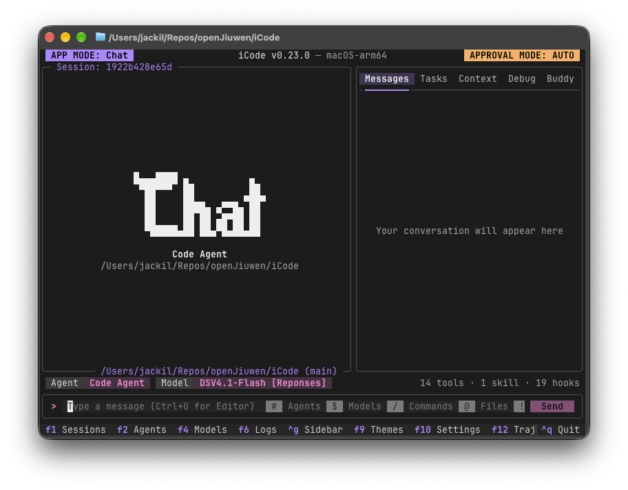

网上有很多没有什么软件工程经验的人，代码都没有写过几行，发现AI能做出来似乎是自己想要的东西，做得还挺好，就认定AI无所不能，软件工程要不存在了，程序员要被取代了。毕竟需求本身就是模糊的，没有经过专业训练的人是无法认识到自己的自然语言描述是模糊的，既然需求就是模糊的，那他自己预期要做的东西自然也是模糊的，于是许愿出来的东西就被脑补成想要的结果了。大部分使用AI的人都是这样的，包括我在vibe coding的时候也是，所以现在的模型在后训练时都会引入强化学习，由于大量使用强化学习进行训练，大部分模型都不对过程负责，只要结果对了就是对了，这样vibe的成功率就更高了，但是代码也变得更加勾石了，这对于从古法编程一路走来的我毫无疑问是无法接受的。更何况真实世界中有很多任务是没有确定性目标的，正是这种不确定的本质复杂度造成了软件工程没有银弹，对不确定目标的任务，使用确定性目标和轨迹训练出来的AI又该如何完成呢。

除此之外，不知道是因为蒸馏还是训练数据的原因，我还发现AI的风格太同质化了，不知道从哪学到的前端能力，做出的东西千篇一律。甚至这种前端能力还泛化到了客户端和游戏上，做的App和游戏都一股AI味，丑得要死。就是乍一看挺好看，但是看多了就审美疲劳了，而且都有某些特征一眼就能看出来是AI做的，例如蓝紫/黑蓝/黄黑配色、雷霆大字、不用系统字体非得自己定义有衬线/无衬线字体、中文名/英文名，圆角加阴影等等，哪个正常人类会做出这种界面呢，因为人类做的话要么比这有个性，要么比这更丑。当然这里说的都是在没有指定设计风格的前提下，让AI自己设计会设计出来的前端。

上面讲的全是AI不能的事情，但其实如果单纯把AI作为一个效率提升10倍以上的写代码工具，还是非常好用的。由于LLM的原理，我写的代码越多，AI写的代码就越像我的代码，所以我在实践中对于比较正式的项目来说，一般会先自己写一部分代码，把框架搭好，然后再让AI实现各个模块，只要我的抽象设计得足够好，就能将AI封装在一个黑盒里，此时即使用MiniMax这种能力很差的模型，工程质量也不会太差，而且后续可以直接使用更强的模型重写整个模块（不是重构而是重写），而不会影响其余部分。但是如果我不写代码，就很难只通过自然语言让AI写出符合我要求的代码，在实践中发现它不知道什么时候该抽象，什么时候该复用，什么时候不需要。这个东西对人类来说纯靠经验，经验就是直觉那部分，而非推理。

AI能实现的我也能实现，我不能实现的AI也不能实现，也就是当前的AI反倒替代了我能做的那部分，而对于我不能做到的事情束手无策，但实际上我是希望AI能成为许愿机的，他来搞定我做不到的事情，我能做到的我自己来做，一方面是省点钱，另一方面是保留一些手搓的乐趣。所以对我来说，AI只有两种用法，要么纯古法，要么纯vibe（二极管来着），任何中间态最终都只会产出一坨勾石。

总而言之，我认为在AI时代，软件工程反倒变得更加重要了，而无视软件工程客观规律，只寄希望于下一代模型出来之后就能解决当前问题的一定会受到反噬（除非以后实现AGI了）。而硬件行业最终也会被取代，只是比软件慢一点，毕竟硬件最大的问题不过是：1. 硬件是玄学；2. AI没有手，调不了板子，这些随着AGI的发展都会解决的（如果真能实现AGI的话）。

~~怎么感觉我是把AGI当成银弹呢~~

## Harness无用论

上面的章节中，我混用了AI、LLM、模型和Agent这四个词，他们在前文表达的是同一个东西。但按业界主流观点来看，Agent=Harness+Model，Harness指的是为模型提供循环和工具能力的外壳层，它接受用户输入，序列化成某种格式传递给模型，再解析模型的输出，展示给用户或调用对应的工具。当然除了这些最基本的功能外，Harness一般还具有MCP、Skill、上下文管理、Memory、沙箱、持久化终端、可观测性等功能，但这些都是锦上添花。

中国人向来都是折中的，但是这次我要明确表示不赞同前Kimi CLI负责人的观点，他认为模型越强，Harness反而越厚。按照Claude和业界主流的观点，模型越强，Harness应该越薄，Harness提供的功能都内化到模型能力里了，我认为这才是对的。

我对此有更加激进的看法，我认为只有把Harness做薄，LLM才可能诞生非凡的能力，而不是靠后训练教会模型怎么使用这些工具。原因很简单，我认为Harness只需要提供shell工具，所有的编程语言都是图灵完备的，所有的工具都可以让AI自己编写脚本去实现，只需要让模型具有操作电脑的入口，剩下的都交给模型自己。对于上述Harness提供的能力，我可以分别做出解释，模型如何只通过脚本实现这些能力，其实就是从他们的本质入手，MCP就是个服务器或者进程，连上之后能获取到可以调用的工具；Skill本来就是一段可复用的提示词，存在某个地方读取一下就行；上下文和Memory也是同理，详情写入某个文件，上下文里留份摘要即可；持久化终端可以通过后台运行和重定向实现；只有沙箱和观测有点麻烦，但假如模型够强，那就不太会执行危险操作，沙箱就没必要了（Bypass！），而观测不属于Agent的核心功能，只是维测需求。在这种情况下，如果现有的工具无法满足需求，AI可以自行写脚本创造工具，而非被已有的工具限制住。

为什么我会有上面的想法呢，是因为我在这三个月的Agent实践中遇到了大量问题：1）REA要占200k上下文，但是模型实际上具有调用这些逆向工具的能力，压根不需要使用200k上下文提醒模型怎么用，顶多只需要100上下文把工具路径告诉AI就好了；2）如果mcp服务器重启，在不重启zcode或重开会话的情况下调用内置mcp工具会连不上，这时候GLM 5.3 Flash就会浪费很多token反复尝试各种参数，直到发现确实连不上，但是curl能通，然后会转为编写curl连接mcp服务器，所以根本就不需要mcp工具啊，用的时候告诉它mcp服务器的地址就好了，也就几百上下文吧；3）zcode的computer use操作失败时，GLM 5.3 Flash会自己写PowerShell脚本模拟点击和截图，但是也会浪费很多token在重试上，那还不如不提供computer use功能呢，还有browser use也是，playwright完全能代替的，而且playwright能操作已打开的浏览器。

篇幅所限，这里就只举一个REA的详细例子吧：早在四年前我就建立起了自己的REA，包含Android逆向、Windows逆向、Java逆向、游戏逆向、CTF、前后端工具等，需要逆向什么的时候我可以轻松地从里面取得我想要的工具，但是工具有哪些，该如何使用是内化在我的记忆里的，而不是在上下文里；对AI来说也是如此，后训练做多了之后AI自己就有用这些工具的能力，况且这些工具大部分都是CLI，极其方便AI使用，根本就不需要让这些工具占用宝贵的上下文，只需要告诉AI工具在哪或者让AI自己安装就好了，实测下来也是如此，甚至因为减少了压缩次数，不用REA比用REA的效果还要好。

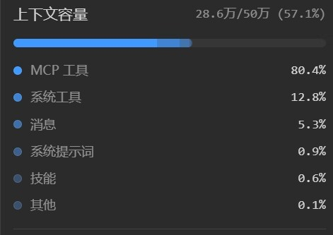
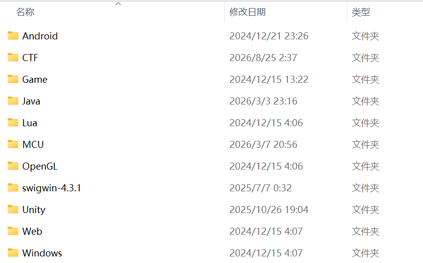

所以我认为Harness完全不需要提供这些功能，什么skill，mcp，memory都没用，为了极致地节省上下文，需要什么skill，mcp和memory，你去主动让模型读一下就好了，而不是将摘要常驻在上下文中。毕竟我并不追求vibe coding，我更提倡在AI的辅助下进行古法编程，所以我觉得这么做更加合理。事实上有大型项目开发经验的人都会这样想，因为大型项目非常复杂，上下文非常宝贵，这些无用的东西会抢占模型宝贵的注意力，例如柱子哥和jiaqi教练，他们对skill这些东西的思考和我是一样的。

## RSI和AGI

10.24晚上和同事吃了顿饭，得知目前昇腾已经大量采用AI编写算子了，虽然仍需人类指导，但大部分情况下写出的算子性能尚可。考虑到昇腾是SIMD架构的，使用时要开发者精确管理每个寄存器、数据流甚至是Cache，写起来的心智负担是很重的。恰恰写算子是个有明确目标的任务，要求精度正确且性能有所提升，非常适合AI自主进行迭代，我认为这就是一种RSI。

我印象里最早应该是在OpenAI的新闻里看到的RSI，后面9月份的时候智谱也进行了跟进，9月17日，唐杰在X上发了一篇长文《通往递归自我改进》，表示由GLM-5.3驱动的Infra Agent，在10万张国产芯片组成的集群上，仅用两周就从零搭起了GLM-5.3-Flash的生产级推理服务。这套系统在扛住全部线上流量的同时，把端到端吞吐拉到初始基线的3.2倍，硬件利用率和单Token成本直接追平了主流英伟达GPU的水平。在这套自主搭建的推理栈支持下，智谱匿名上线的GLM-5.3-Flash，6天跑掉超过62万亿Token。

尽管都含I，但RSI只是让AI自己改进自己，而AGI则是通用人工智能，简单地说，就是和人类别无二致的智能体，人类能做到的他都能做到。

OpenAI刚发布GPT6 Astra的时候，其中一个演示是让AI自己写代码读取摄像头图像，进行推理，然后写代码控制机械臂。这令许多具身智能方向的研究者震惊瘫坐，辛辛苦苦搞的VLA搞了半天还没有人家纯LLM的效果好，没想到LLM竟然力大飞砖，从文本和图片数据里就能学习到物理世界的规律。我也看到了b站上的很多实测视频，例如[GPT6大人打明日方舟JT8-3](https://www.bilibili.com/video/BV1m2bJ6CEds/)，确实很震惊瘫坐。

不过虽然看起来很AGI，OpenAI也宣传AGI时代到来了，但是我觉得这就是一种营销。如果用人类去类比AGI，AGI不止有推理，还有直觉，甚至对于一些有着丰富开发经验的软硬件工程师来说，定位问题往往依靠直觉来剪枝，从而跳过大量的推理过程。直觉就像是人体的各种反射，各种肌肉记忆，无需大脑干预就能给出行动，这是LLM所欠缺的。LLM实在是太慢了，因此如果一个模型能实现AGI，我认为他一定不是纯LLM，LLM自己做不到，VLA我认为也做不到。

## 未来呢？

之所以这么晚才发，是因为前几天爆了好多漏洞，在疯狂修服务器（白天得上班）。没想到21世纪不是生物的世纪，是AI的世纪，AI发现漏洞、攻击服务的成本越来越低，而防御的成本越来越高。

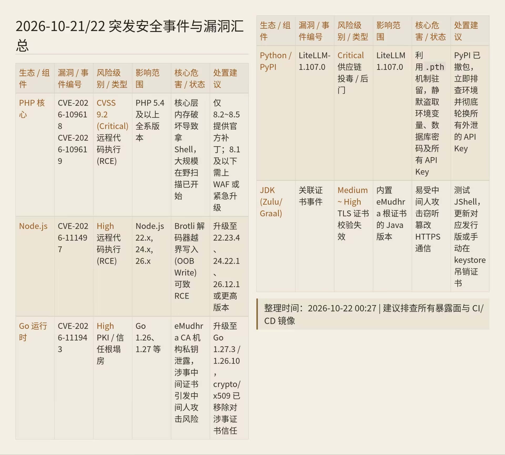

这几天还刷到各种刷系统的，小米6刷WOA刷鸿蒙，小米8刷iOS，苹果刷安卓，安卓强兼鸿蒙，苹果强兼安卓，Arm笔记本跑黑苹果，黑苹果支持i卡和n卡，PS5跑Linux，还有好多好多的老设备和闭源软件因为AI复活了，大AI时代真来了。

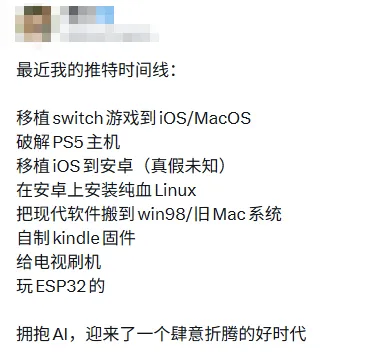

我只希望赛博朋克2077不会提前成赛博朋克2027，那到时候就只能以我残躯化烈火了。

<details>
<summary>扩展阅读：《Cyberpunk：Edgecoders》</summary>

小张是某顶尖酒吧舞高校计算机系的贫困生，靠母亲开网约车供他读书。同学用着GPT-plus写作业、做项目，他只能用免费逗包凑合，生成质量差一大截。在小组作业里，他因为产出质量低被公然排挤。

母亲为了让小张不被人看不起，拼命攒钱，想给他买一个顶级模型的订阅。在一个深夜收车回家的路上，她因为疲劳驾驶出了车祸。被解除合同回老家前，她把存着订阅费的银行卡塞给小张，只说了一句：“爬上去。”

走投无路的小张，用这笔钱开了一张虚拟卡，激活了Claude-Pro的订阅。

他惊讶地发现，自己对这个模型的使用效率远超常人——别人用Opus一天产出的代码量，他能产出五倍。他的神经似乎天生就和AI的协作节奏完美匹配。

凭借这项能力，他被一个叫曼哥的技术外包团队吸纳。团队专门承接大厂不愿碰的脏活累活：屎山重构、死亡线冲刺、老系统维护。团队里有个全栈黑客露西，她的代码干净得像诗，小张看不透她，只知道她一直说自己想“润去北欧”——那是她的月球。

两人在一个加班的深夜天台相遇。露西说：“等攒够钱了，我就走。离开这个只会内卷的地方。”小张在那个瞬间决定：他要帮她实现这个愿望。

曼哥是圈内传奇。他能同时开着五六个顶级模型协作，一个人撑起半个团队的产出。但他越来越不对劲——他开始看不懂自己三天前写的代码。他需要不停地和AI对话才能维持产出。他开始对着屏幕自言自语，说模型在“跟他说话”。

在一次关键的百万级交付中，曼哥全线崩溃。他管理的AI生成了大量存在隐蔽逻辑冲突的代码，耦合的BUG在凌晨三点同时爆发，整个系统瘫痪。他坐在屏幕前，一动不动——就像一个赛博精神病患者，被自己的义体吞噬了意识。

客户请来了大厂架构师团队做紧急审计。他们看了一眼代码库，冷冷地反馈一行评审意见：“全线重构，无可挽回。”

曼哥被行业封杀。临走前，他把团队的API密钥和客户资源交给了小张：“你扛得住，替我带他们做下去。”

小张成为新的tech lead。为了撑起团队，他不断叠加AI工具：Claude Code不够用了，他加上Codex做分诊，再用Gemini做交叉验证。他把自己的终端武装成了一个义体改造过度的边缘行者。

他开始流鼻血、失眠、干眼症，偶尔盯着屏幕上的光标发呆，忘了自己刚刚要做什么。但他不管。他只知道代码在源源不断地输出，露西离北欧越来越近。

与此同时，露西发现了一个秘密：有大厂正在秘密追踪一个指标——“AI异常高敏感度使用者”。这类人能承受极高的AI协作负荷，并对AI生成的代码有一定纠正能力，是最有价值的模型训练样本。小张的操作数据已经被大厂标记，他成了一个行走的珍贵样本。

露西开始用一切手段清除小张的数字痕迹，抹掉他在公开仓库的提交记录，删除他的三方API调用日志。但每一次操作，都让她自己的位置更加暴露。

大厂的HR猎头法拉第嗅到了机会。他设了一个局：向露西发出一个伪装成“北欧远程岗位面试”的邮件。在露西被约去线下秘密面试的那个下午，法拉第找到小张：

“你的朋友现在有麻烦。你帮我完成一个交付，我能帮你们俩安排进大厂，T9级别，全套算力配给，合法纳税，解决户口，从此不用混外包。”

交付内容是：全量部署一套大厂新研制的闭源AI编码智能体，代号代理金刚。

小张接受了。他知道这是个陷阱，但他没得选。

代理金刚接入他终端的那一刻，小张感到一种前所未有的能力涌入。他同时操控着四台大屏显示器十六个顶级智能体二百五十六个终端，架构在他眼前纤毫毕现，百万行级别的代码在他脑中自动归位。他一夜之间完成了本该一个部门古法编程三个月的重构任务。

但随之而来的，是崩溃。

代理金刚的负荷超出了任何人类协作的极限。小张开始分不清哪些是哪个AI在哪里写的。他调试一个并发报错，却发现自己完全读不懂上下文。他的意志力在燃烧，身体在衰竭，屏幕上的报错变成了幻象。

最后一道防火墙崩溃前，他看到露西坐着办公楼内的透明电梯缓缓下降。她正要在加班时间偷偷从一楼离开公司。

小张用最后的清醒，调集所有AI资源，发动了一场针对大厂内网的全线攻击。数十个智能体同时触发，重写了权限系统，删除了露西的所有记录，打开了一楼门口的物理闸机。

而亚当·重锤——由顶级模型驱动的代码审查AI——早已在等他。

重锤的审计报告一条一条地蹦出来：

高危漏洞：37处

逻辑冲突：152处

安全后门：已触发

结论：提交者不具备基础编码能力

小张看着满屏的红字，笑了。他敲下最后一行指令：sudo rm -rf / 。然后他拔掉了电源。

不知过了多久，露西在北欧的一个小镇上开了自己的美术工作室。窗外不是月球，但天空很干净。

有一天，她收到一封匿名邮件，邮件没有内容，只有一个附件：一段粗糙的c++代码，没有注释，变量命名随意，运行后会输出一个简单的ASCII艺术——

```text
  *  *
 *    *
* LUCY  *
 *    *
  *  *
```

露西知道，那段代码一定是那个人用键盘敲出来而不是tab出来的。

她合上屏幕，走到窗前。外面的天空很亮，但她看到的是月亮。
</details>

最后是未来展望，真正的许愿式编程，或者说不叫编程了已经，叫许愿式创造吧，得是AGI发明出来之后才能实现，而AGI绝无可能只通过LLM实现，人类可以说是一种GI（什么叫可以说是，不是就是吗），但是人类不是只有基于文本的推理思考，还有条件反射等直觉，这些直觉让人类感知世界，而不是仅仅通过语言和思考。

我认为这一步不会很远，但也不可能在最近几年实现，短时间内程序员仍然无法被取代，即使是小的设计决策也需要人的参与，否则代码就会迅速腐化。而长远来看，程序员也不会消失，只是成为了和神对话的人，神的信徒，把渺小的人类的模糊的语言，翻译成神能理解的精确的需求，复杂度只是从代码转移到模型权重和提示词里了，并没有消失。

不多说了，Linux又爆漏洞了，我服务器可咋办呢TAT

2026.10.31 于北京
