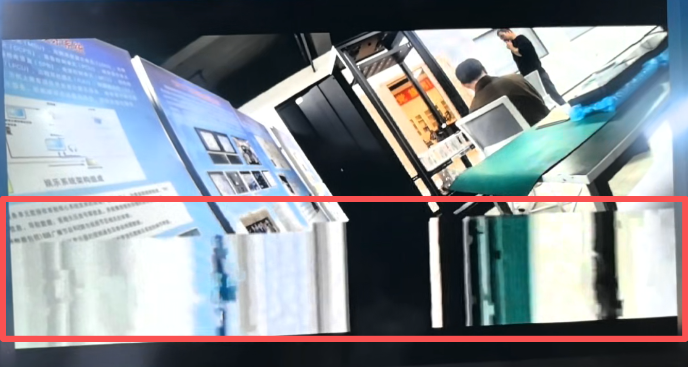
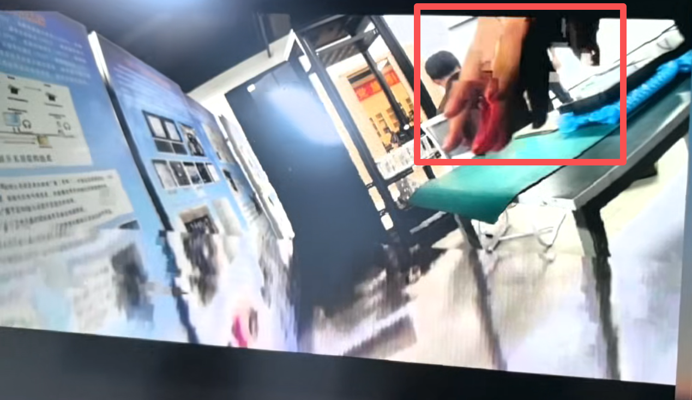

这是一个RTSP、RTP 和 MJPEG over HTTP流媒体播放器，现在遇到了播放RTP视频流图像抖动的问题，同一个摄像头设备直连（排除网络干扰），通过RTSP协议播放正常，通过RTP组播在画面变化时会产生如图所示的马赛克和“撕裂”（第二张图中红框本来是一个完整的手，但是画面撕裂了），同时用wireshark抓包，发现抓到的包没有丢包，是能正常播放的（抓到的包是根目录下的两个pcapng）；在电脑上用VLC验证过RTSP和RTP也均不存在该画面撕裂问题，现在希望你仔细分析并修复该问题。如果需要修改thirdparty中的第三方库可以直接进行修改。
你需要先阅读README.md确认项目基本信息，例如本项目为了保证极致低延迟必须使用单缓冲区，因此竞态产生的画面撕裂不是造成该问题的原因，同时本项目明确指出不支持b帧，而出现问题的码流是IPC的码流，也没有b帧。
